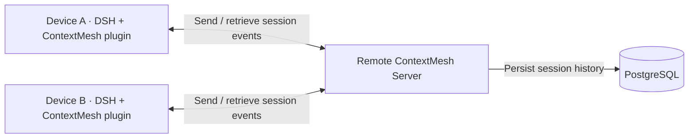

# ContextMesh

English | [中文](README.zh.md)

**One conversation. Different devices. Different models.**

Start a task on your laptop, continue on another machine, and switch models while keeping the original conversation and tool history.

ContextMesh has two parts: **a plugin on each device that sends and retrieves session events** and **one shared remote server that persists them in PostgreSQL**. [DeepSeek Harness](https://github.com/deepseek-ai/deepseek-harness) is the first supported client; support for other coding agents is planned.

[Deploy the server](#1-deploy-the-server) · [Install the plugin](#2-install-the-plugin-on-each-device) · [Connect devices](#3-connect-your-devices) · [Use ContextMesh](#4-continue-a-conversation)

## How it fits together



| Component  | Where it runs                            | What it needs                                                      | What it does                                                                                                                         |
| ---------- | ---------------------------------------- | ------------------------------------------------------------------ | ------------------------------------------------------------------------------------------------------------------------------------ |
| **Server** | One machine reachable by your devices    | PostgreSQL and service credentials                                 | Persists session history in PostgreSQL, authenticates devices, and coordinates ownership and transfers                               |
| **Plugin** | Inside DSH on every participating device | The server URL, a device credential, and locally configured models | Sends native session events to the server, retrieves history for restoration, and provides shared conversations and handoff controls |

Deploy the server once. Each device connects to that same service; it does not need its own database. A server machine can also run DSH, in which case it also needs the plugin. Model requests and tools run on the device executing the task; model API keys stay on that device.

The server's PostgreSQL database is the authoritative store for shared session history. Device-local files retain connection settings, device identity, model credentials, caches, and handoff state.

## What you can do

- **Keep native context:** the plugin sends messages, tool calls, results, and execution events to the remote server for persistence in PostgreSQL.
- **Continue across devices:** hand off explicitly, or confirm a takeover. For an unfinished task, the receiver is checked before the source stops, then execution continues automatically.
- **Use the receiver's model:** a device configured only with Sol can continue a Flash task. Select models through DSH's native selector; devices do not need identical model configurations.
- **Bring selected files:** preview and confirm workspace changes and supported file attachments before applying them on the receiver.

## Before you install

**0.7.0 is a developer preview.** The plugin requires this repository's pinned **DSH 0.2.1-rc.3 and compatibility patches**. Use the runtime built below; installing the plugin into an arbitrary global DSH is not supported.

The instructions below use the available source installation path. Self-contained macOS Apple Silicon and Linux x64 packages are also built by CI, but are currently **candidate artifacts, not published releases**. Their installation and upgrade commands are covered in the [runtime guide](docs/runtime.md).

## 1. Deploy the server

**Run on the service host.** Requires Git and Docker Compose. For the default HTTPS connection, also prepare a service domain and a TLS reverse proxy. This starts the API and PostgreSQL; Node and DSH do not need to be installed on the host.

```sh
git clone https://github.com/MarsZheng666/ContextMesh.git contextmesh-server
cd contextmesh-server
cp .env.example .env
chmod 600 .env
```

Set these two values in the server's `.env`:

| Setting             | Value                                                              |
| ------------------- | ------------------------------------------------------------------ |
| `CONTEXTMESH_TOKEN` | A random owner credential, used to connect the first owner device  |
| `POSTGRES_PASSWORD` | A different random PostgreSQL password; add this setting to `.env` |

Generate each value separately with `openssl rand -hex 32`. For this Compose deployment, the database address and API bind settings are supplied by [deploy/compose.yml](deploy/compose.yml); the example `DATABASE_URL` is for native local development.

```sh
docker compose --env-file .env -f deploy/compose.yml up --build -d
docker compose --env-file .env -f deploy/compose.yml ps
```

The API is available on the **server's** `http://127.0.0.1:8787`. PostgreSQL stays inside the Docker network and keeps its data in a named volume.

**HTTPS direct connection is the default for devices.** Configure a service domain such as `https://mesh.example.com`, point its DNS to the server, and put a TLS reverse proxy in front of `127.0.0.1:8787`. See [HTTPS server configuration](docs/deployment.md#https-direct-connection-default) for the proxy example and certificate requirements. All devices then use this same HTTPS URL with their own credentials.

[SSH tunneling](docs/deployment.md#optional-ssh-tunnel) is an optional alternative when you want to keep the API accessible only through SSH. Local development on the service host can use `http://127.0.0.1:8787`. The ContextMesh API URL is separate from the DSH Web UI URL.

See [server installation and configuration](docs/deployment.md) for an existing PostgreSQL database, persistent data, and upgrades.

## 2. Install the plugin on each device

**Run on every machine that will execute tasks.** Requires Git, **Node.js 24.9+**, and **pnpm 11.25.0**. Use a separate client checkout even if the server is on the same machine, so its `.env` does not override device credentials.

```sh
git clone https://github.com/MarsZheng666/ContextMesh.git contextmesh-client
cd contextmesh-client
corepack enable
pnpm install --frozen-lockfile
pnpm build

export DSH_HOME="$HOME/.dsh-contextmesh"
export CONTEXTMESH_NODE_NAME='My laptop'
pnpm exec dsh plugin --profile web add "link:$PWD/packages/handoff-deepseek"
```

This installs **one plugin: `dsh-contextmesh-handoff`**. The session transport adapter and handoff UI load together. Give each device its own DSH home and name. Keep using the same `DSH_HOME` in subsequent commands and launches.

Only the service host needs PostgreSQL. Device checkouts do not need a server `.env`, `pnpm db:local`, or `pnpm start`.

## 3. Connect your devices

### First device: owner connection

In the client checkout and the same terminal, set the service URL reachable from this device and the owner token from the server's `.env`:

```sh
export CONTEXTMESH_ENDPOINT='https://mesh.example.com'
export CONTEXTMESH_TOKEN='your-server-owner-token'
pnpm cli doctor
pnpm exec dsh --profile web --host 127.0.0.1 --port 3080 --no-open
```

Replace `https://mesh.example.com` with the HTTPS service URL configured above. No SSH tunnel is needed for this default connection.

Open the authenticated URL printed by DSH, then configure a model provider in DSH. These environment settings apply to the current terminal; load them again on later launches, or use the [private connection-file setup](docs/getting-started.md#save-the-owner-connection) for persistent configuration.

### Additional devices: pairing

After installing the plugin on the new device:

1. On the owner device, open **Remote sessions → Service connection → Add or revoke a device**. Name the new device and create a one-time pairing code.
2. On the new device, from its client checkout with its own `DSH_HOME` set, run:

   ```sh
   unset CONTEXTMESH_TOKEN CONTEXTMESH_ENDPOINT
   pnpm cli setup
   ```

3. Choose **pairing code**, enter the same HTTPS service URL used by the owner device, then enter the code. The wizard saves this device's credential and identity privately.
4. Start DSH and configure its local model provider:

   ```sh
   pnpm cli doctor
   pnpm exec dsh --profile web --host 127.0.0.1 --port 3080 --no-open
   ```

Open the URL printed by that DSH instance. Devices on different machines can use the same Web port.

Do not copy the owner's `.env`, DSH home, or model keys to other devices. Paired devices receive separate, revocable credentials. All devices paired with this server share its conversation namespace. **ContextMesh pairing, DSH browser login, and model-provider authentication are separate.** See [device access and revocation](docs/devices.md).

## 4. Continue a conversation

Open **Remote sessions** to see connected devices and shared conversations. Map a project to a local directory on each device when prompted; the paths can differ.

- In the source conversation, choose an online target and select **Hand off**.
- Or open the conversation on another device, send a message, and confirm **Take over here**.
- The receiver uses its locally selected model. If it has no explicit selection yet, it uses its DSH default. Model compatibility and context capacity are checked before transfer.

Ordinary conversations work in non-Git folders. Code workspaces need the same Git base commit; uncommitted changes can use the confirmed file-transfer flow. ContextMesh does not clone repositories, switch branches, or synchronize entire directories automatically.

See [handoff](docs/handoff.md), [model relay](docs/model-relay.md), and [file transfer](docs/files.md) for supported cases and recovery. Model relay currently supports text and completed tool history; file transfer supports native file attachments, with images, spill resources, and live processes outside the current scope.

## Upgrades and troubleshooting

| What you are maintaining                                             | Guide                                   |
| -------------------------------------------------------------------- | --------------------------------------- |
| Server, PostgreSQL, network access, and backups                      | [Server deployment](docs/deployment.md) |
| Plugin installation, persistent connection settings, and model login | [Device setup](docs/getting-started.md) |
| Packaged runtimes, connection diagnostics, and controlled upgrades   | [Runtime management](docs/runtime.md)   |
| Pairing codes, device credentials, and revocation                    | [Device access](docs/devices.md)        |

Keep the server and participating devices on compatible versions. Back up PostgreSQL and stop writers before upgrading; schema-changing upgrades and upgrades from a server without the maintenance API need the procedures in the runtime guide. Current schema: **6**.

## Development

Run `pnpm check` from a built client checkout to check formatting, types, builds, upstream fixtures, and tests. Tests use an isolated PostgreSQL instance and need no model API credentials.

See [CONTRIBUTING.md](CONTRIBUTING.md), the [plugin API](docs/api/deepseek-adapter.md), or [open an issue](https://github.com/MarsZheng666/ContextMesh/issues).
