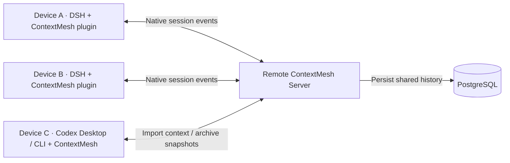

# ContextMesh

English | [中文](README.zh.md)

**Your context, across devices, models and coding agents.**

Keep conversation and tool history on a shared server. Continue a DSH task on another device, or confirm takeover into Codex CLI and continue unfinished work with that device's own model and workspace. On Mac, use the ContextMesh sidebar in Codex Desktop to receive tasks and publish saved conversations.

ContextMesh combines **one shared remote Server** with **integrations on the devices that execute tasks**: a single [DeepSeek Harness](https://github.com/deepseek-ai/deepseek-harness) plugin and an optional Codex bridge built into the ContextMesh CLI.

[Deploy the server](#1-deploy-the-server) · [Install a device client](#2-install-a-device-client) · [Connect devices](#3-connect-your-devices) · [DSH handoff](#4-continue-a-conversation-in-dsh) · [Codex Desktop](#use-the-codex-desktop-sidebar) · [Codex CLI](#5-continue-with-codex-cli)

## How it fits together



| Component        | Where it runs                             | Configure                                                          | Responsibility                                                                         |
| ---------------- | ----------------------------------------- | ------------------------------------------------------------------ | -------------------------------------------------------------------------------------- |
| **Server**       | One host reachable by your devices        | PostgreSQL, service credentials, HTTPS URL                         | Persist shared context, authenticate devices, coordinate ownership and transfers       |
| **DSH plugin**   | Inside DSH on each participating device   | Server connection and local models                                 | Send and restore native events; provide shared sessions, handoff and takeover controls |
| **Codex bridge** | Through ContextMesh CLI on a Codex device | The same Server connection, local Codex login, model and directory | Import or confirm task takeover, run Codex locally, archive results to the Server      |

Deploy the Server once. Devices share its HTTPS URL and use separate credentials; they need no local PostgreSQL. The service host needs a device integration only if it also executes tasks. Model requests and tools run on the executing device, and model credentials stay there.

**Shared context is persisted remotely in PostgreSQL.** The DSH plugin transports session events. The Codex bridge archives native thread, turn and item snapshots after acknowledged runs; Codex also maintains its native local history. Device-local files retain configuration, credentials, caches and recovery journals. Unrelated Codex activity is not automatically synchronized.

## What works today

| Workflow                            | Current behavior                                                                                                                                                                 |
| ----------------------------------- | -------------------------------------------------------------------------------------------------------------------------------------------------------------------------------- |
| **DSH → DSH, across devices**       | Hand off or confirm takeover of the same session. For running work, check the receiver before stopping the source, then continue automatically.                                  |
| **Switch models in DSH**            | Use the receiver's native model selection; a device with only Sol can continue a Flash task. Models need not match across devices.                                               |
| **DSH → Codex Desktop / CLI**       | Confirm on the receiver, preflight it before stopping DSH, then automatically continue unfinished work in a new Codex thread.                                                    |
| **Codex → DSH**                     | Copy a settled archive or a snapshot published from Codex Desktop into a new DSH conversation with the receiver's model and chosen folder; send the next instruction when ready. |
| **Managed Codex → Codex CLI**       | Import an archived snapshot into another local Codex thread with that receiver's model and directory.                                                                            |
| **Selected workspace files in DSH** | Preview and confirm supported changes and native file attachments before applying them on the receiver.                                                                          |

Codex snapshot imports create a separate conversation and retain source provenance. **DSH → Codex takeover requires explicit receiver confirmation. Codex → DSH copies a settled archive and waits for your next instruction; it does not take over live Codex execution.** See [DSH handoff](docs/handoff.md), [Codex usage](docs/codex.md), [return to DSH](docs/codex-return.md), and [native storage](docs/native-agents.md).

## Before you install

**0.8.0-dev.9 is an unreleased source preview.** The plugin requires this repository's pinned **DSH 0.2.1-rc.3 and compatibility patches**. Use the pinned source build below; installing the plugin into an arbitrary global DSH is not supported.

Use the same reviewed source version for the Server and device clients. The instructions below use the source installation path. Self-contained macOS Apple Silicon and Linux x64 packages are also built by CI, but are currently **candidate artifacts, not published releases**. Their installation and upgrade commands are covered in the [runtime guide](docs/runtime.md).

## 1. Deploy the server

**Run on the service host.** Requires Git and Docker Compose. For the default HTTPS connection, also prepare a service domain and a TLS reverse proxy. This starts the API and PostgreSQL; Node and DSH do not need to be installed on the host.

```sh
git clone https://github.com/MarsZheng666/ContextMesh.git contextmesh-server
cd contextmesh-server
cp .env.example .env
chmod 600 .env
```

Set these two values in the server's `.env`:

| Setting             | Value                                                              |
| ------------------- | ------------------------------------------------------------------ |
| `CONTEXTMESH_TOKEN` | A random owner credential, used to connect the first owner device  |
| `POSTGRES_PASSWORD` | A different random PostgreSQL password; add this setting to `.env` |

Generate each value separately with `openssl rand -hex 32`. For this Compose deployment, the database address and API bind settings are supplied by [deploy/compose.yml](deploy/compose.yml); the example `DATABASE_URL` is for native local development.

```sh
docker compose --env-file .env -f deploy/compose.yml up --build -d
docker compose --env-file .env -f deploy/compose.yml ps
```

The API is available on the **server's** `http://127.0.0.1:8787`. PostgreSQL stays inside the Docker network and keeps its data in a named volume.

**HTTPS direct connection is the default for devices.** Configure a service domain such as `https://mesh.example.com`, point its DNS to the server, and put a TLS reverse proxy in front of `127.0.0.1:8787`. See [HTTPS server configuration](docs/deployment.md#https-direct-connection-default) for the proxy example and certificate requirements. All devices then use this same HTTPS URL with their own credentials.

[SSH tunneling](docs/deployment.md#optional-ssh-tunnel) is an optional alternative when you want to keep the API accessible only through SSH. Local development on the service host can use `http://127.0.0.1:8787`. The ContextMesh API URL is separate from the DSH Web UI URL.

See [server installation and configuration](docs/deployment.md) for an existing PostgreSQL database, persistent data, and upgrades.

## 2. Install a device client

**Run on each device that will execute tasks.** The source CLI requires Git, **Node.js 24.9+**, and **pnpm 11.25.0**. Use a separate client checkout even if the server is on the same machine, so its `.env` does not override device credentials.

```sh
git clone https://github.com/MarsZheng666/ContextMesh.git contextmesh-client
cd contextmesh-client
corepack enable
pnpm install --frozen-lockfile
pnpm build
```

**Codex-only device:** the ContextMesh CLI is now built. Skip the DSH plugin installation and configure the connection in step 3, then follow [step 5](#5-continue-with-codex-cli). Install and configure Codex CLI separately; ContextMesh does not bundle it.

### DSH: install the single plugin

In the same terminal:

```sh
export DSH_HOME="$HOME/.dsh-contextmesh"
export CONTEXTMESH_NODE_NAME='My laptop'
pnpm exec dsh plugin --profile web add "link:$PWD/packages/handoff-deepseek"
```

This installs **one plugin: `dsh-contextmesh-handoff`**. The session transport adapter and handoff UI load together. Give each device its own DSH home and name. Keep using the same `DSH_HOME` in subsequent commands and launches.

Only the service host needs PostgreSQL. Device checkouts do not need a server `.env`, `pnpm db:local`, or `pnpm start`.

## 3. Connect your devices

### First device: owner connection

In the client checkout and the same terminal, set the service URL reachable from this device and the owner token from the server's `.env`:

```sh
export CONTEXTMESH_ENDPOINT='https://mesh.example.com'
export CONTEXTMESH_TOKEN='your-server-owner-token'
pnpm cli doctor
```

For a DSH device, start its Web UI:

```sh
pnpm exec dsh --profile web --host 127.0.0.1 --port 3080 --no-open
```

Replace `https://mesh.example.com` with the HTTPS service URL configured above. No SSH tunnel is needed for this default connection.

For DSH, open its printed authenticated URL and configure a model provider. For Codex, configure its login and provider locally and continue with step 5. These environment settings apply to the current terminal; load them again on later launches, or use the [private connection-file setup](docs/getting-started.md#save-the-owner-connection) for persistent configuration.

### Additional devices: pairing

After building the device CLI, and installing the plugin if this is a DSH device:

1. On an owner DSH device, open **Remote sessions → Service connection → Add or revoke a device**. Name the new device and create a one-time pairing code.
2. On the new device, from its client checkout, run the setup wizard. DSH devices keep their own `DSH_HOME` set:

   ```sh
   unset CONTEXTMESH_TOKEN CONTEXTMESH_ENDPOINT
   pnpm cli setup
   ```

3. Choose **pairing code**, enter the same HTTPS service URL used by the owner device, then enter the code. The wizard saves this device's credential and identity privately.
4. For DSH, start its Web UI and configure its local model provider. For a Codex-only device, configure Codex locally and continue with step 5:

   ```sh
   pnpm cli doctor
   pnpm exec dsh --profile web --host 127.0.0.1 --port 3080 --no-open
   ```

DSH users open the URL printed by that instance. Devices on different machines can use the same Web port.

Do not copy the owner's `.env`, DSH home, or model keys to other devices. Paired devices receive separate, revocable credentials. All devices paired with this server share its conversation namespace. **ContextMesh pairing, DSH browser login, and model-provider authentication are separate.** See [device access and revocation](docs/devices.md).

## 4. Continue a conversation in DSH

Open **Remote sessions** to see connected devices and shared conversations. Map a project to a local directory on each device when prompted; the paths can differ.

- In the source conversation, choose an online target and select **Hand off**.
- Or open the conversation on another device, send a message, and confirm **Take over here**.
- The receiver uses its locally selected model. If it has no explicit selection yet, it uses its DSH default. Model compatibility and context capacity are checked before transfer.

Ordinary conversations work in non-Git folders. Code workspaces need the same Git base commit; uncommitted changes can use the confirmed file-transfer flow. ContextMesh does not clone repositories, switch branches, or synchronize entire directories automatically.

See [handoff](docs/handoff.md), [model relay](docs/model-relay.md), and [file transfer](docs/files.md) for supported cases and recovery. Model relay currently supports text and completed tool history; file transfer supports native file attachments, with images, spill resources, and live processes outside the current scope.

## 5. Continue with Codex CLI

Use the built client checkout and Server connection from steps 2–3. Install and configure Codex CLI on the receiving device; the bridge was validated with **Codex CLI 0.154.0**. Its local login and provider settings supply the model credentials.

To take over a running DSH task, review the local model and directory, then confirm on the receiver:

```sh
pnpm cli codex takeover SOURCE_SESSION_ID \
  --cwd /absolute/path/to/local/project \
  --model YOUR_LOCAL_CODEX_MODEL --workspace-write --confirm
```

The receiver checks its model, context and workspace before DSH stops. Running tools must settle. Once the source closes and its final history is saved, Codex continues an unfinished task once. Completed tasks start no new work. DSH retains read-only history linked to the new Codex session. Keep the command running until completion. Git workspaces require the same clean commit; files are not copied. See [confirmed takeover and recovery](docs/confirmed-takeover.md).

For an independent snapshot copy that keeps source ownership, finish the source turn and its tools, then:

```sh
pnpm cli list
pnpm cli codex import SOURCE_SESSION_ID \
  --cwd /absolute/path/to/local/project \
  --model YOUR_LOCAL_CODEX_MODEL
```

Choose a directory and model available on this device. Import creates a new thread and returns a `sessionId` starting with `codex:`; it starts no model turn. Use that returned ID to continue:

```sh
pnpm cli codex run CODEX_SESSION_ID --message "Continue from the previous result."
pnpm cli codex status CODEX_SESSION_ID
```

Add `--from codex` to import a managed Codex snapshot. Use `pnpm cli list --adapter codex` to list its remote archives. With a managed runtime package, use `contextmesh` in place of `pnpm cli`.

The default native sandbox is **read-only**; select `--workspace-write` on import when edits are intended. Source tool history becomes reference text, and files are not copied. Existing unmanaged Codex threads are not automatically collected. Text and settled tool history are supported; unsupported attachments and uncertain tool outcomes block import. After an interrupted run, inspect `status` and use the documented stopped-process reconciliation flow before resending work. See [the Codex guide](docs/codex.md) for configuration, limits and recovery.

### Use the Codex Desktop sidebar

On your Mac, [install the managed runtime](docs/runtime.md), connect it to the Server shared by your devices using `contextmesh setup`, then enable the sidebar.

```sh
contextmesh codex install-panel
```

In Codex Desktop, select **ContextMesh** in the sidebar. Import a saved session, confirm a supported live takeover, or publish a saved Codex conversation for another compatible agent to open. Choose **Conversation text only** when a full archive is too large. [Desktop setup and usage](docs/codex-desktop.md)

### Bring a Codex archive back to DSH

In the receiving DSH's ContextMesh panel, select **Continue a Codex archive**, choose a local folder and confirm. The existing plugin creates a separate conversation using DSH's local model. Import starts no model work; send your next instruction there. The receiver needs no Codex installation. CLI users can run `pnpm cli import-codex CODEX_SESSION_ID --cwd /local/directory --confirm` while that DSH instance is running. See [archive return and recovery](docs/codex-return.md).

## Upgrades and troubleshooting

| What you are maintaining                                           | Guide                                   |
| ------------------------------------------------------------------ | --------------------------------------- |
| Server, PostgreSQL, network access, and backups                    | [Server deployment](docs/deployment.md) |
| DSH plugin, persistent connection settings, and model login        | [Device setup](docs/getting-started.md) |
| Return a Codex archive to DSH                                      | [Codex → DSH](docs/codex-return.md)     |
| Codex import, native execution, and interrupted-run recovery       | [Codex bridge](docs/codex.md)           |
| Packaged runtimes, connection diagnostics, and controlled upgrades | [Runtime management](docs/runtime.md)   |
| Pairing codes, device credentials, and revocation                  | [Device access](docs/devices.md)        |

Keep the server and participating devices on compatible versions. Back up PostgreSQL and stop writers before upgrading; schema-changing upgrades and upgrades from a server without the maintenance API need the procedures in the runtime guide. Current schema: **8**.

## Development

Run `pnpm check` from a built client checkout to check formatting, types, builds, upstream fixtures, and tests. Tests use an isolated PostgreSQL instance and need no model API credentials.

See [CONTRIBUTING.md](CONTRIBUTING.md), the [plugin API](docs/api/deepseek-adapter.md), or [open an issue](https://github.com/MarsZheng666/ContextMesh/issues).
