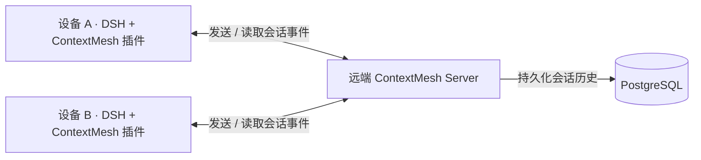

# ContextMesh

[English](README.md) | 中文

**同一个会话，跨设备、跨模型继续。**

在笔记本上开始任务，到另一台机器上继续执行，切换模型时保留原始对话和工具历史。

ContextMesh 由两部分组成：**每台设备上负责发送和读取会话事件的插件**，以及**将会话数据持久化到 PostgreSQL 的共享远端 Server**。首个支持的客户端是 [DeepSeek Harness](https://github.com/deepseek-ai/deepseek-harness)，后续将扩展至其他 Coding Agent。

[部署 Server](#1-部署-server) · [安装插件](#2-在每台设备上安装插件) · [连接设备](#3-配置设备连接) · [开始接续](#4-继续同一个会话)

## 项目如何组成



| 组件       | 安装在哪里                    | 需要配置什么                    | 负责什么                                                               |
| ---------- | ----------------------------- | ------------------------------- | ---------------------------------------------------------------------- |
| **Server** | 一台各设备可访问的机器        | PostgreSQL、服务鉴权凭据        | 将会话历史持久化到 PostgreSQL、验证设备身份、协调会话归属与交接        |
| **插件**   | 每台参与任务的设备上的 DSH 中 | Server 地址、设备凭据、本机模型 | 向 Server 发送原生会话事件、读取历史以恢复会话、提供共享会话与交接操作 |

Server 部署一次，各设备连接同一个服务，无需各自安装数据库。如果服务器机器本身也要运行 DSH 执行任务，就在它的 DSH 中同样安装插件。模型调用和工具执行发生在当前执行任务的设备上，模型 API Key 留在该设备。

共享会话的完整历史以服务端 PostgreSQL 数据库为准。本机文件保留连接配置、设备身份、模型凭据、缓存和交接状态。

## 可以做什么

- **保留原生上下文：** 插件将消息、工具调用、工具结果和执行事件发送到远端 Server，由 Server 持久化到 PostgreSQL。
- **换台设备继续：** 主动交接或确认接管。对于未完成任务，先预检接收端，再安全停止原设备，随后自动继续执行。
- **使用接收端的模型：** 只配置 Sol 的设备也能接续 Flash 的任务。直接使用 DSH 原生模型选择器，无需两端配置相同模型。
- **带上选定文件：** 预览并确认工作区改动及受支持的文件附件，再在接收端应用。

面向集成开发者，原生存储现支持按适配器区分日志。目前尚未提供 Codex/Claude 插件或跨 Agent 自动接续，详见[原生存储接口](docs/native-agents.zh.md)。

## 安装前了解

**0.8.0-dev.1 为尚未发布的源码预览版。** 插件依赖本仓库锁定的 **DSH 0.2.1-rc.3 和兼容补丁**。请使用下方构建的运行时，不支持直接装入任意全局 DSH。

以下采用当前可用的源码安装方式。CI 也会构建包含运行环境的 macOS Apple Silicon 和 Linux x64 安装包，但目前它们是**候选产物，尚未作为正式 Release 发布**。候选包的安装与升级方式见[运行包指南](docs/runtime.zh.md)。

## 1. 部署 Server

**在服务端机器执行。** 需要 Git 和 Docker Compose；默认 HTTPS 连接还需准备服务域名和 TLS 反向代理。这一步启动 API 与 PostgreSQL，宿主机无需安装 Node 或 DSH。

```sh
git clone https://github.com/MarsZheng666/ContextMesh.git contextmesh-server
cd contextmesh-server
cp .env.example .env
chmod 600 .env
```

在服务端的 `.env` 中设置以下两个值：

| 配置                | 如何填写                                                     |
| ------------------- | ------------------------------------------------------------ |
| `CONTEXTMESH_TOKEN` | 随机生成的所有者凭据，用来连接首台所有者设备                 |
| `POSTGRES_PASSWORD` | 另一个随机生成的 PostgreSQL 密码；需要在 `.env` 中添加这一项 |

分别运行 `openssl rand -hex 32` 生成两个不同的值。此 Compose 部署的数据库地址和 API 监听配置由 [deploy/compose.yml](deploy/compose.yml) 提供；示例中的 `DATABASE_URL` 用于本地原生开发环境。

```sh
docker compose --env-file .env -f deploy/compose.yml up --build -d
docker compose --env-file .env -f deploy/compose.yml ps
```

API 地址为**服务器本机**的 `http://127.0.0.1:8787`。PostgreSQL 仅在 Docker 网络内访问，数据保存在命名卷中。

**设备默认通过 HTTPS 直连。** 配置服务域名，例如 `https://mesh.example.com`，将 DNS 指向服务器，并通过 TLS 反向代理转发到 `127.0.0.1:8787`。代理示例和证书要求见[HTTPS 服务端配置](docs/deployment.zh.md#https-直连默认)。各设备使用同一个 HTTPS 地址和各自的凭据连接。

[SSH 隧道](docs/deployment.zh.md#可选-ssh-隧道)是可选方案，适用于希望 API 仅通过 SSH 访问的部署。同机本地开发可使用 `http://127.0.0.1:8787`。ContextMesh API 地址与 DSH 网页地址是两个不同入口。

自行管理的 PostgreSQL、数据存放位置和升级步骤见[服务端安装与配置](docs/deployment.zh.md)。

## 2. 在每台设备上安装插件

**在每台要执行任务的机器上执行。** 需要 Git、**Node.js 24.9+** 和 **pnpm 11.25.0**。即使 Server 与 DSH 在同一台机器，也使用独立的客户端目录，避免服务端 `.env` 覆盖设备凭据。

```sh
git clone https://github.com/MarsZheng666/ContextMesh.git contextmesh-client
cd contextmesh-client
corepack enable
pnpm install --frozen-lockfile
pnpm build

export DSH_HOME="$HOME/.dsh-contextmesh"
export CONTEXTMESH_NODE_NAME='My laptop'
pnpm exec dsh plugin --profile web add "link:$PWD/packages/handoff-deepseek"
```

只安装 **`dsh-contextmesh-handoff` 一个插件**，会话传输适配器和交接界面一起加载。每台设备使用自己的 DSH 主目录和设备名称，后续命令及启动时保持相同的 `DSH_HOME`。

只有服务端需要 PostgreSQL。设备的客户端目录无需创建服务端 `.env`，也无需运行 `pnpm db:local` 或 `pnpm start`。

## 3. 配置设备连接

### 首台设备：连接为所有者

在客户端目录的同一终端中，配置本设备可访问的服务地址，以及服务端 `.env` 中的所有者 Token：

```sh
export CONTEXTMESH_ENDPOINT='https://mesh.example.com'
export CONTEXTMESH_TOKEN='your-server-owner-token'
pnpm cli doctor
pnpm exec dsh --profile web --host 127.0.0.1 --port 3080 --no-open
```

将 `https://mesh.example.com` 替换为前面配置的 HTTPS 服务地址。这是默认连接方式，无需建立 SSH 隧道。

打开 DSH 打印的带认证信息的地址，再在 DSH 中配置模型提供方。这些环境变量只对当前终端生效，后续启动需要重新加载；希望长期保存配置时，使用[私有连接文件](docs/getting-started.zh.md#保存所有者连接)。

### 其他设备：通过配对加入

在新设备安装插件后：

1. 在所有者设备打开 **Remote sessions → Service connection → Add or revoke a device**，填写新设备名称，生成一次性配对码。
2. 在新设备的客户端目录中，设置好它自己的 `DSH_HOME`，然后执行：

   ```sh
   unset CONTEXTMESH_TOKEN CONTEXTMESH_ENDPOINT
   pnpm cli setup
   ```

3. 选择 **pairing code**，输入与所有者设备相同的 HTTPS 服务地址和配对码。向导会私密保存该设备独有的凭据与身份。
4. 启动 DSH，并配置本机模型提供方：

   ```sh
   pnpm cli doctor
   pnpm exec dsh --profile web --host 127.0.0.1 --port 3080 --no-open
   ```

打开该 DSH 打印的地址。不同机器上的 DSH 可以使用相同网页端口。

不要把所有者的 `.env`、DSH 主目录或模型密钥复制给其他设备。配对设备会获得独立、可撤销的凭据；同一 Server 下的配对设备共享其会话命名空间。**ContextMesh 设备配对、DSH 网页登录、模型提供方鉴权是三件不同的事。** 详见[设备权限与撤销](docs/devices.zh.md)。

## 4. 继续同一个会话

打开 **Remote sessions** 查看设备和共享会话。需要工作目录时，按提示为项目选择每台设备上的本地目录，两端路径可以不同。

- 在来源会话中选择在线目标设备，点击 **Hand off**。
- 或在另一台设备打开该会话，发送消息时确认 **Take over here**。
- 接收端使用本机选择的模型，尚未明确选择时使用 DSH 默认模型。交接前会检查模型兼容性和上下文容量。

普通对话支持非 Git 目录。代码工作区需要相同的 Git 基准提交，未提交改动可通过确认式文件传输带过去。ContextMesh 不会自动克隆仓库、切换分支或同步整个目录。

支持范围和恢复方式见[会话交接](docs/handoff.zh.md)、[模型接力](docs/model-relay.zh.md)及[文件传输](docs/files.zh.md)。模型接力目前支持文本和已完成的工具历史；文件传输支持原生文件附件，图片、spill 资源和运行中的进程暂不支持。

## 升级与排查

| 需要维护的部分                     | 对应指南                               |
| ---------------------------------- | -------------------------------------- |
| Server、PostgreSQL、网络访问和备份 | [服务端部署](docs/deployment.zh.md)    |
| 插件安装、持久连接配置和模型登录   | [设备配置](docs/getting-started.zh.md) |
| 独立运行包、连接诊断和受控升级     | [运行环境管理](docs/runtime.zh.md)     |
| 配对码、设备凭据和撤销             | [设备权限](docs/devices.zh.md)         |

Server 和参与设备需要使用兼容版本。升级前备份 PostgreSQL 并停止写者；跨数据库结构版本、旧服务端尚无维护接口等情况，按运行包指南操作。当前数据库结构版本为 **7**。

## 参与开发

在已构建的客户端源码目录运行 `pnpm check`，检查格式、类型、构建、上游夹具和测试。测试使用隔离的 PostgreSQL，不需要模型 API 凭据。

参阅 [CONTRIBUTING.md](CONTRIBUTING.md)、[插件接口](docs/api/deepseek-adapter.md)，或提交 [GitHub Issue](https://github.com/MarsZheng666/ContextMesh/issues)。
