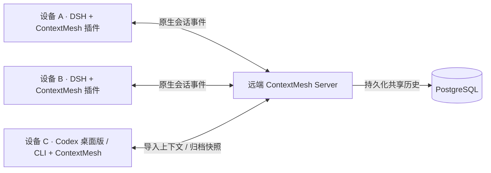

# ContextMesh

[English](README.md) | 中文

**让上下文跨设备、跨模型、跨 Coding Agent 延续。**

将对话和工具历史保存在共享 Server，在另一台设备继续 DSH 任务，或确认转移至 Codex CLI，使用接收端自己的模型和工作区自动继续未完成的任务。在 Mac 上，也可以从 Codex 桌面侧栏接管任务或发布已保存的会话。

ContextMesh 由**一个共享远端 Server**和**执行任务设备上的集成组件**组成：唯一的 [DeepSeek Harness](https://github.com/deepseek-ai/deepseek-harness) 插件，以及内置于 ContextMesh CLI 的可选 Codex 适配器。

[部署 Server](#1-部署-server) · [安装设备客户端](#2-安装设备客户端) · [连接设备](#3-配置设备连接) · [DSH 会话交接](#4-在-dsh-中继续同一个会话) · [Codex CLI](#5-使用-codex-cli-接续任务) · [Codex 桌面版](#使用-codex-桌面侧栏)

## 项目如何组成



| 组件             | 运行在哪里                        | 需要配置                                      | 负责什么                                            |
| ---------------- | --------------------------------- | --------------------------------------------- | --------------------------------------------------- |
| **Server**       | 一台各设备可访问的主机            | PostgreSQL、服务凭据、HTTPS 地址              | 持久化共享上下文、验证设备身份、协调会话归属和交接  |
| **DSH 插件**     | 每台参与任务的设备上的 DSH 中     | Server 连接、本机模型                         | 发送和恢复原生事件，提供共享会话、交接和接管入口    |
| **Codex 适配器** | Codex 设备上的 ContextMesh CLI 中 | 同一 Server 连接、本机 Codex 登录、模型和目录 | 导入快照或确认接管任务，在本机运行 Codex 并远程归档 |

Server 部署一次。各设备使用同一个 HTTPS 地址和独立凭据连接，无需本机 PostgreSQL。服务端主机只有同时执行任务时才需要设备集成。模型调用和工具执行发生在执行任务的设备上，模型凭据留在该设备。

**共享上下文由远端 PostgreSQL 持久化。** DSH 插件负责传输会话事件；Codex 适配器在确认运行结果后归档原生线程、轮次和事件快照，Codex 自身也保留原生本地历史。设备本地文件用于配置、凭据、缓存和恢复记录；其他 Codex 操作不会被自动同步。

## 当前支持范围

| 使用场景                     | 当前行为                                                                                          |
| ---------------------------- | ------------------------------------------------------------------------------------------------- |
| **跨设备 DSH → DSH**         | 主动交接或确认接管同一会话。执行中的任务先预检接收端，再停止源端，随后自动继续。                  |
| **在 DSH 中切换模型**        | 使用接收端原生模型选择；只配置 Sol 的设备也可继续 Flash 的任务，两端模型无需一致。                |
| **DSH → Codex 桌面版 / CLI** | 接收端确认后先预检，再安全停止 DSH，将未完成任务带入新 Codex 线程自动续跑。                       |
| **Codex → DSH**              | 将稳定归档或桌面版发布的快照复制成新的 DSH 会话，使用接收端模型和所选目录，等待你发送下一条指令。 |
| **托管 Codex → Codex CLI**   | 将已归档快照导入另一本机 Codex 线程，使用接收端模型和目录。                                       |
| **DSH 选定文件传输**         | 在接收端应用前，预览并确认受支持的工作区改动和原生文件附件。                                      |

Codex 快照导入会创建独立会话并保留来源。**DSH → Codex 接管必须由接收端明确确认；Codex → DSH 复制稳定归档后等待你的下一条指令，不接管运行中的 Codex。** 详见 [DSH 交接](docs/handoff.zh.md)、[Codex 使用指南](docs/codex.zh.md)、[返回 DSH](docs/codex-return.zh.md)和[原生存储](docs/native-agents.zh.md)。

## 安装前了解

**0.8.0-dev.9 为尚未发布的源码预览版。** 插件依赖本仓库锁定的 **DSH 0.2.1-rc.3 和兼容补丁**。请使用下方锁定版本的源码构建，不支持直接装入任意全局 DSH。

Server 与设备客户端请使用同一经审核的源码版本。以下采用源码安装方式。CI 也会构建包含运行环境的 macOS Apple Silicon 和 Linux x64 安装包，但目前它们是**候选产物，尚未作为正式 Release 发布**。候选包的安装与升级方式见[运行包指南](docs/runtime.zh.md)。

## 1. 部署 Server

**在服务端机器执行。** 需要 Git 和 Docker Compose；默认 HTTPS 连接还需准备服务域名和 TLS 反向代理。这一步启动 API 与 PostgreSQL，宿主机无需安装 Node 或 DSH。

```sh
git clone https://github.com/MarsZheng666/ContextMesh.git contextmesh-server
cd contextmesh-server
cp .env.example .env
chmod 600 .env
```

在服务端的 `.env` 中设置以下两个值：

| 配置                | 如何填写                                                     |
| ------------------- | ------------------------------------------------------------ |
| `CONTEXTMESH_TOKEN` | 随机生成的所有者凭据，用来连接首台所有者设备                 |
| `POSTGRES_PASSWORD` | 另一个随机生成的 PostgreSQL 密码；需要在 `.env` 中添加这一项 |

分别运行 `openssl rand -hex 32` 生成两个不同的值。此 Compose 部署的数据库地址和 API 监听配置由 [deploy/compose.yml](deploy/compose.yml) 提供；示例中的 `DATABASE_URL` 用于本地原生开发环境。

```sh
docker compose --env-file .env -f deploy/compose.yml up --build -d
docker compose --env-file .env -f deploy/compose.yml ps
```

API 地址为**服务器本机**的 `http://127.0.0.1:8787`。PostgreSQL 仅在 Docker 网络内访问，数据保存在命名卷中。

**设备默认通过 HTTPS 直连。** 配置服务域名，例如 `https://mesh.example.com`，将 DNS 指向服务器，并通过 TLS 反向代理转发到 `127.0.0.1:8787`。代理示例和证书要求见[HTTPS 服务端配置](docs/deployment.zh.md#https-直连默认)。各设备使用同一个 HTTPS 地址和各自的凭据连接。

[SSH 隧道](docs/deployment.zh.md#可选-ssh-隧道)是可选方案，适用于希望 API 仅通过 SSH 访问的部署。同机本地开发可使用 `http://127.0.0.1:8787`。ContextMesh API 地址与 DSH 网页地址是两个不同入口。

自行管理的 PostgreSQL、数据存放位置和升级步骤见[服务端安装与配置](docs/deployment.zh.md)。

## 2. 安装设备客户端

**在每台要执行任务的设备上执行。** 源码 CLI 需要 Git、**Node.js 24.9+** 和 **pnpm 11.25.0**。即使 Server 与 DSH 在同一台机器，也使用独立的客户端目录，避免服务端 `.env` 覆盖设备凭据。

```sh
git clone https://github.com/MarsZheng666/ContextMesh.git contextmesh-client
cd contextmesh-client
corepack enable
pnpm install --frozen-lockfile
pnpm build
```

**只使用 Codex 的设备：** ContextMesh CLI 到这里已构建完成。跳过 DSH 插件安装，按第 3 步配置连接，再进入[第 5 步](#5-使用-codex-cli-接续任务)。Codex CLI 需要单独安装和配置，ContextMesh 不捆绑它。

### DSH：安装唯一的插件

在同一终端中执行：

```sh
export DSH_HOME="$HOME/.dsh-contextmesh"
export CONTEXTMESH_NODE_NAME='My laptop'
pnpm exec dsh plugin --profile web add "link:$PWD/packages/handoff-deepseek"
```

只安装 **`dsh-contextmesh-handoff` 一个插件**，会话传输适配器和交接界面一起加载。每台设备使用自己的 DSH 主目录和设备名称，后续命令及启动时保持相同的 `DSH_HOME`。

只有服务端需要 PostgreSQL。设备的客户端目录无需创建服务端 `.env`，也无需运行 `pnpm db:local` 或 `pnpm start`。

## 3. 配置设备连接

### 首台设备：连接为所有者

在客户端目录的同一终端中，配置本设备可访问的服务地址，以及服务端 `.env` 中的所有者 Token：

```sh
export CONTEXTMESH_ENDPOINT='https://mesh.example.com'
export CONTEXTMESH_TOKEN='your-server-owner-token'
pnpm cli doctor
```

DSH 设备再启动网页界面：

```sh
pnpm exec dsh --profile web --host 127.0.0.1 --port 3080 --no-open
```

将 `https://mesh.example.com` 替换为前面配置的 HTTPS 服务地址。这是默认连接方式，无需建立 SSH 隧道。

DSH 用户打开它打印的带认证信息的地址，再配置模型提供方；Codex 用户在本机配置其登录和模型服务，随后进入第 5 步。这些环境变量只对当前终端生效，后续启动需要重新加载；希望长期保存配置时，使用[私有连接文件](docs/getting-started.zh.md#保存所有者连接)。

### 其他设备：通过配对加入

在新设备构建 CLI，并按需安装 DSH 插件后：

1. 在所有者的 DSH 设备打开 **Remote sessions → Service connection → Add or revoke a device**，填写新设备名称，生成一次性配对码。
2. 在新设备的客户端目录运行设置向导；DSH 设备保持自己的 `DSH_HOME`：

   ```sh
   unset CONTEXTMESH_TOKEN CONTEXTMESH_ENDPOINT
   pnpm cli setup
   ```

3. 选择 **pairing code**，输入与所有者设备相同的 HTTPS 服务地址和配对码。向导会私密保存该设备独有的凭据与身份。
4. DSH 设备启动网页界面并配置本机模型；只使用 Codex 的设备在本机配置 Codex 后进入第 5 步：

   ```sh
   pnpm cli doctor
   pnpm exec dsh --profile web --host 127.0.0.1 --port 3080 --no-open
   ```

DSH 用户打开该实例打印的地址。不同机器上的 DSH 可以使用相同网页端口。

不要把所有者的 `.env`、DSH 主目录或模型密钥复制给其他设备。配对设备会获得独立、可撤销的凭据；同一 Server 下的配对设备共享其会话命名空间。**ContextMesh 设备配对、DSH 网页登录、模型提供方鉴权是三件不同的事。** 详见[设备权限与撤销](docs/devices.zh.md)。

## 4. 在 DSH 中继续同一个会话

打开 **Remote sessions** 查看设备和共享会话。需要工作目录时，按提示为项目选择每台设备上的本地目录，两端路径可以不同。

- 在来源会话中选择在线目标设备，点击 **Hand off**。
- 或在另一台设备打开该会话，发送消息时确认 **Take over here**。
- 接收端使用本机选择的模型，尚未明确选择时使用 DSH 默认模型。交接前会检查模型兼容性和上下文容量。

普通对话支持非 Git 目录。代码工作区需要相同的 Git 基准提交，未提交改动可通过确认式文件传输带过去。ContextMesh 不会自动克隆仓库、切换分支或同步整个目录。

支持范围和恢复方式见[会话交接](docs/handoff.zh.md)、[模型接力](docs/model-relay.zh.md)及[文件传输](docs/files.zh.md)。模型接力目前支持文本和已完成的工具历史；文件传输支持原生文件附件，图片、spill 资源和运行中的进程暂不支持。

## 5. 使用 Codex CLI 接续任务

使用第 2–3 步构建的客户端目录和 Server 连接。在接收端单独安装并配置 Codex CLI；适配器已使用 **Codex CLI 0.154.0** 验证。模型凭据由其本机登录和模型服务配置提供。

接管正在执行的 DSH 任务时，在接收端核对本机模型和目录，然后确认：

```sh
pnpm cli codex takeover SOURCE_SESSION_ID \
  --cwd /absolute/path/to/local/project \
  --model YOUR_LOCAL_CODEX_MODEL --workspace-write --confirm
```

先检查接收端模型、上下文和工作区，再等待已执行的工具结束，让 DSH 安全停止并保存最终历史。未完成的任务在 Codex 中续跑一次；已完成的任务不启动新工作。DSH 保留只读历史，并显示关联的 Codex 会话。命令运行期间保持终端开启。Git 工作区需相同且干净的提交，不自动复制文件。详见[确认接管与恢复](docs/confirmed-takeover.zh.md)。

需要保留来源所有权、单独复制快照时，先结束源端当前轮次及工具调用，再执行：

```sh
pnpm cli list
pnpm cli codex import SOURCE_SESSION_ID \
  --cwd /absolute/path/to/local/project \
  --model YOUR_LOCAL_CODEX_MODEL
```

目录和模型选择本机可用的值。导入会创建新线程，返回以 `codex:` 开头的 `sessionId`，不会启动模型轮次。使用返回的 ID 继续：

```sh
pnpm cli codex run CODEX_SESSION_ID --message "根据之前的结果继续。"
pnpm cli codex status CODEX_SESSION_ID
```

导入托管 Codex 快照时增加 `--from codex`；通过 `pnpm cli list --adapter codex` 查看其远程归档。使用托管运行包时，将 `pnpm cli` 换成 `contextmesh`。

默认原生运行权限为**只读**；需要编辑时在导入命令中选择 `--workspace-write`。源端工具历史作为引用文本传入，不复制工作区文件，也不自动采集已有非托管 Codex 线程。当前支持文本和已确认的工具历史；不支持的附件和不确定的工具结果会阻止导入。运行中断后，先检查 `status`，按文档确认旧进程停止并核对归档，再考虑重发指令。配置、限制和恢复步骤见 [Codex 使用指南](docs/codex.zh.md)。

### 使用 Codex 桌面侧栏

在 Mac 上[安装托管运行时](docs/runtime.zh.md)，用 `contextmesh setup` 连接各设备共享的 Server，然后启用侧栏。

```sh
contextmesh codex install-panel
```

在 Codex 桌面版左侧栏点击 **ContextMesh**。可以导入已保存的会话、确认接管受支持的在线任务，也可以发布已保存的 Codex 会话供其他兼容 Agent 打开。完整归档太大时，可选 **Conversation text only**（仅会话文字）。[桌面版安装与使用](docs/codex-desktop.zh.md)

### 将 Codex 归档带回 DSH

在接收端 DSH 的 ContextMesh 面板选择 **Continue a Codex archive / 继续 Codex 归档**，选择本机文件夹并确认。现有插件使用 DSH 本机模型创建独立会话，导入不启动模型工作；发送下一条指令即可继续。接收端无需安装 Codex。CLI 用户在该 DSH 实例运行时执行 `pnpm cli import-codex CODEX_SESSION_ID --cwd /local/directory --confirm`。详见[归档返回与恢复](docs/codex-return.zh.md)。

## 升级与排查

| 需要维护的部分                     | 对应指南                               |
| ---------------------------------- | -------------------------------------- |
| Server、PostgreSQL、网络访问和备份 | [服务端部署](docs/deployment.zh.md)    |
| DSH 插件、持久连接配置和模型登录   | [设备配置](docs/getting-started.zh.md) |
| 将 Codex 归档返回 DSH              | [Codex → DSH](docs/codex-return.zh.md) |
| Codex 导入、原生执行和中断恢复     | [Codex 适配器](docs/codex.zh.md)       |
| 独立运行包、连接诊断和受控升级     | [运行环境管理](docs/runtime.zh.md)     |
| 配对码、设备凭据和撤销             | [设备权限](docs/devices.zh.md)         |

Server 和参与设备需要使用兼容版本。升级前备份 PostgreSQL 并停止写者；跨数据库结构版本、旧服务端尚无维护接口等情况，按运行包指南操作。当前数据库结构版本为 **8**。

## 参与开发

在已构建的客户端源码目录运行 `pnpm check`，检查格式、类型、构建、上游夹具和测试。测试使用隔离的 PostgreSQL，不需要模型 API 凭据。

参阅 [CONTRIBUTING.md](CONTRIBUTING.md)、[插件接口](docs/api/deepseek-adapter.md)，或提交 [GitHub Issue](https://github.com/MarsZheng666/ContextMesh/issues)。
