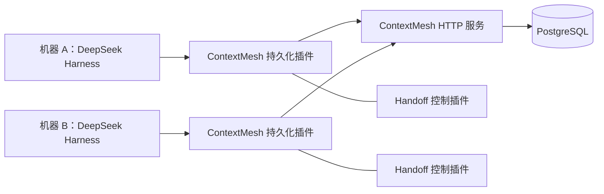

# MVP：远程 Session 与可控 Handoff

状态：本轮源码预研后的设计建议，尚未实现。用户确认的方向见 [决策记录](../decisions.md)，源码依据见 [预研报告](../research/deepseek-harness.md)。

## 范围和阶段

| 阶段 | 交付能力 | 完成条件 |
| --- | --- | --- |
| M0 | 原生 Session 远程持久化、重启恢复 | 两组上游契约通过；重启后读取 flush 已确认的完整日志 |
| M1 | 同 Harness 双机器的主动 Handoff | A 停止并释放写权，B 目录映射后从同一日志继续，A 不能继续追加 |
| M2 | 同 Harness 跨模型接力 | 显式记录模型切换，首个目标请求使用目标路由，保留先前历史 |
| 后续 | 异构 Agent 接力、附件同步、故障恢复 | 分别通过能力协商和适配器验收，不计入首个闭环 |

MVP 采用单用户、文本任务、单服务实例、一个 PostgreSQL 数据库。客户端可分布在不同机器；不做多主协同写入、离线写后合并、运行中工具迁移、自动重放外部副作用、自动抢占故障机器、全文检索、向量数据库或自动摘要覆盖原文。

同一个原生 Session 同时最多一个写者。可并发只读。原生历史与可移植上下文分开存放；M0/M1 先保存原生 DSH 事件，不先建立“所有 Agent 通用事件”的大一统接口。

## 服务结构

服务核心不导入 DSH 类型或依赖模型 API。它保存带 adapter/encoding 标识的 JSON 记录并管理顺序、写权和持久性；DSH adapter 校验并解释 DSH 事件。服务端仍校验 JSON 大小、身份、连续 seq 和 envelope，不盲信客户端。恢复端在执行任何模型或工具前验证格式与必需事件词汇。

建议 TypeScript ESM + Node.js（对齐所固定上游要求）和 PostgreSQL。数据库直接存事件，避免首期对象存储与数据库双写。具体 HTTP 框架和数据库驱动留在实现 PR 固定。

## 数据模型

所有查询和唯一约束都包括 `namespace`；MVP 只有一个配置的 namespace，凭证在服务端映射，不能信任请求体自报租户身份。

| 表 / 对象 | 关键内容 | 不变量 |
| --- | --- | --- |
| `sessions` | namespace、mesh ID、adapter ID、native ID、native format、header、inheritedEventCount、nextSeq、durableNextSeq、generation、materialized | native ID 在 namespace + adapter 内唯一；header 原样且不可变；fork cut 单独保存 |
| `events` | session、seq、完整原生 JSON | `(session, seq)` 唯一；不覆盖、不删改已有记录；不根据通用 role 重写事件 |
| `write_claims` | session/reservation、owner、epoch、expiresAt、状态 | 事务内原子取得；epoch 单调增长；续期不改变 epoch |
| `requests` | namespace、operationId、session、epoch、请求摘要、结果 | 同 operationId + 相同请求返回原结果；不同请求内容拒绝 |
| `handoffs` | handoff ID、session、阶段、来源/目标、最终 durableNextSeq、manifest | 只能由持有当前写权的来源准备；ready 之后才允许目标接手 |
| `handoff_manifest` | repo 标识、commit、干净工作区证明、目录映射要求、插件/模型能力清单、外部资源清单 | 不包含凭证；记录可恢复依赖，不能把路径当作可在另一机器直接使用的资源 |

服务协议版本、上下文文档版本、DSH 原生格式版本分别命名。DSH `SessionPersistenceRevision` 由适配器把服务 generation 映射成实例内 opaque token；写权检查必须使用独立 epoch，不能复用 revision。

MVP 只接受固定格式的 DSH 原生日志。更旧/更新版本返回明确的 unsupported 错误，保留数据；不在通用存储层自动迁移。以后支持其他 Agent 时增加 adapter encoding，不让核心调用 DSH 校验函数。

## 写入、读取与持久性

1. `create` 在服务端建立隐藏 reservation、返回写权；当前插件实例维护 pending header，因此本实例 stat/list/open-read 可见。其他实例不可发现。第一次非空 append 或显式 flush 在事务内 materialize；从未 materialize 的空 pending 在 close 时删除 reservation。
2. provider 监听 `session/event`，按 handle 串行排队并批量发送。队列有明确大小上限、批量大小、等待时间和请求超时；这些为可配置值。队列满或写失败必须保留错误并阻止下一 checkpoint，不丢记录、不开启隐式离线分支。
3. append 请求带 operationId、epoch、expectedNextSeq、连续 events 和请求摘要。事务锁定 session/claim 行，检查有效写权、seq 和幂等状态，然后原子插入整批、推进 nextSeq 并记录结果。进程崩溃不能留下半批可见数据。
4. 首期 append 在 PostgreSQL durable commit 后才响应，其保证强于上游 best-effort append。flush 仍存在：排空适配器 live 队列，等待所有此前请求并确认 durableNextSeq，必要时物化空 Session。成功才可继续下游模型和工具。
5. 服务成功响应的 durable commit 以 PostgreSQL fsync / 同步提交配置为前提；首期只承诺数据库进程/应用进程崩溃恢复，不承诺磁盘丢失、跨区域灾难或异步副本故障切换。服务启动检查所需数据库配置。
6. 网络超时表示结果未知。使用相同 operationId 重试，或查询该操作结果；不能生成新 ID 盲目追加。去重记录的保留期至少覆盖活跃 handle 与可重试窗口，过期的未知写入必须人工核对，不能猜测未执行。
7. 读操作走主库，不走滞后副本。一次分段读取先固定 snapshot generation 和终点，后续页只返回该切面；恢复先拼出从 seq 0 开始的连续完整日志再发布 Session。适配器将网络返回值校验、收养为独占事件数组，返回合法 `eventState`。
8. close 幂等，按顺序 drain、flush、释放写权；失败不能报告 handoff 成功。失权后不能拿旧 epoch 释放新写者；失败或超时由服务保留可查询状态。零事件且从未 materialize 的 pending 走第 1 条例外。

服务的 list 可以分页，但上游 `list()` 返回全量快照，适配器需要遍历分页后再返回。对于活动日志，同实例在 append/flush 完成后的新读取至少看到该前缀；同 handle 不倒退。`stat/list` 的 metadata 必须反映同一权威存储进度。

## 写权与网络分区

服务端租约时间使用数据库时间；所有 append/flush/release 都原子检查 owner + epoch + 有效期。续期失败后，适配器将 handle 永久标为失权，映射成 `SessionOwnershipLostError`，阻止后续写入并停止驱动新工作。读 handle 不占写权。

fencing 保护的是日志写入。一个已开始的 shell 命令或外部 API 副作用不会因为租约失效而自动停止；仅有 TTL 和 checkpoint 不能保证外部副作用恰好执行一次。因此 M1 只支持来源可协作停止并收到最终 close 确认的交接。租约过期且来源状态不明时，服务进入 recovery-required，不自动允许新的执行者接管；未来恢复需确认旧执行者已终止并核查工具副作用。

现有 checkpoint-policy 负责请求/工具边界的持久性，但新插件仍要在失权时停止新驱动并暴露错误。长时间运行中的工具、插件热卸载和服务故障要单独测试，不能由“最后写者获胜”覆盖历史。

## 建议 HTTP 协议草案

以下为 ContextMesh 自有 API 草案，不是声称上游存在这些端点。JSON schema / OpenAPI 在实现 PR 中固定。

| 路径 | 用途 |
| --- | --- |
| `POST /v1/sessions` | create reservation；返回 session ID、claim、epoch 和 pending 状态 |
| `POST /v1/sessions/{id}/handles` | 打开 read/write handle，write 原子检查 claim 及交接状态 |
| `GET /v1/sessions/{id}`、`GET /v1/sessions` | stat / 分页 list；隐藏未公开的 pending |
| `GET /v1/handles/{id}/events` | offset / length / snapshot 分页读取 |
| `POST /v1/handles/{id}/append` | 幂等原子批次写入 |
| `POST /v1/handles/{id}/flush` | durable barrier，返回 durableNextSeq |
| `POST /v1/handles/{id}/renew` | 当前 epoch 的写权续期 |
| `POST /v1/handles/{id}/close` | 幂等关闭 read/write handle |
| `GET /v1/operations/{id}` | 查询未知结果；按 namespace 鉴权 |
| `POST /v1/sessions/{id}/handoffs` | 当前来源准备交接，阻止新的 prompt intake |
| `POST /v1/handoffs/{id}/finalize` | 来源已停止且 claim 已成功释放后，记录最终切点并置 ready |
| `POST /v1/handoffs/{id}/accept` | 指定目标原子消费 ready 交接并取得下一 epoch |

上游 service.flush 是适配器对活跃 write handles 的一次快照遍历，聚合各 flush 结果，不需要额外的全租户“刷新所有 Session”远程操作。

HTTP 状态配结构化错误码：404 absent、409 exists/owned/seq/idempotency conflict、明确的 ownership-lost、closed、unsupported-format、corrupt、unauthorized 和 unavailable。适配器将业务错误映射到对应 DSH typed error；网络 unavailable 不谎报成 corruption。

鉴权采用配置的单用户 bearer token，日志脱敏；非本机连接使用 TLS。凭证只存在本地环境/配置和服务端身份配置中，不进入 Session、manifest 或代码仓库。服务设置 payload、批次和分页上限。

## 主动 Handoff 的完整顺序

1. A 的 Handoff 控制器先关闭新 prompt intake，标记 preparing；服务在该阶段不允许其他写者绕过 handoff 通过普通 open 获取写权。
2. 等待当前任务和工具到达静止状态。首期不做工具中途迁移。确认 inbox 没有待处理输入；否则显式处理或拒绝交接，不丢输入。
3. 预检 B 的 workspace 映射、repo identity、相同 commit、工作区干净状态、所需插件/preset、模型和资源。预检失败则 A 仍拥有写权，可以退出 preparing 并恢复 intake。
4. A 调用 sessions.flush，随后通过持有的 AgentHandle.dispose 停止 loop、等待最终 closing events，并让存储 close 排空与释放写权。早先 flush 的切点只是临时值，不能当作最终切点。
5. A 查询已持久化的最终 durableNextSeq，finalize manifest 并置 ready。finalize 校验来源 close 已成功及此后无新写入。失败则交接保持未完成，B 不能运行。
6. B accept 后取得新的 epoch；同一交接只能成功消费一次。用 accept 取得的 claim 完成持久化插件的首次 write open，不能在 resume 中再重复抢一次写权。具体方式是将 claim 以一次性状态注入插件，open 校验并消费它，仍遵守 SessionPersistence 的单 handle 行为。
7. B 通过 `ctx.agents.resume` 恢复；在 setup 中验证并调用 workingDirectory.set 映射本地目录，在首次运行前 flush。原始 header 和既有事件不改写。
8. M2 如需换模型，显式 model.select 并 flush，再接受下一条 prompt。服务记录交接成功；A 的旧 claim 不能再写。

accept 后 B 在 resume/setup 失败的路径须关闭 claim，并记录失败状态；不能将交接标成已完成。重新尝试需新的显式领取流程，且不能重复驱动工具。跨机器代码同步首期由用户已有 Git 流程准备，不自动提交、推送或复制未提交代码。

## 跨模型与后续可移植上下文

M2 在同 Harness 内延续同一原生日志；目标模型必须支持实际使用的工具/输入类型，或有明确可测试的适配。验证上下文窗口、工具 schema、图像能力和 provider 特有内容。首期文本范围仍遇到不支持的必需内容时，拒绝模型接力并展示原因。

后续独立的 `TaskContext v1` 可包含：目标、已确认决定、完成/待办、代码定位、测试证据、风险与未知项、repo/commit、artifact refs、来源 Session 和精确事件范围。摘要附来源与可追溯切点，不取代原生历史；目标 Agent 建立自己的新 Session。权限、密钥、进行中的工具和模型内部推理状态不属于可移植保证。

## 验收清单

- M0：两组上游共享契约通过，包括 pending 可见性、closed/read-only、fork cut、未知必需事件拒绝及 ignorable 保留；失败重试不重复、不丢失、不乱序。
- M0：真实数据库重启和服务进程重启后，恢复全部 flush 已确认事件；未完成事务无半批可见。read handle 单调读取；所有句柄的 flush 聚合错误。
- M0：两个独立插件实例竞争同一写权只有一个成功；读不受写权阻塞；旧 epoch 的 append/flush/release 被拒绝。
- M1：两个独立 Harness 进程 A→B 接续。停机时最终事件存在、最终切点准确；原始 header 不变、cwd 变化为新事件，B 的下一工具在正确目录执行。
- M1：目录/commit 不匹配、附件缺失、inbox 非空、close 超时或失败、服务不可达时，交接不会报告成功；来源不明不自动接管。
- M1：ready 前不能用普通 open 抢写权；accept 重试不重复领取；accept 后 setup 失败关闭 claim 并可诊断。
- M2：假模型 A/B 验证新路由、顺序和历史；真实模型 A/B 验证接续同一个有明确检查结果的小任务。凭证缺失时明确列为未执行。

当前这些是后续验收要求，尚无一项运行时验收已完成。
